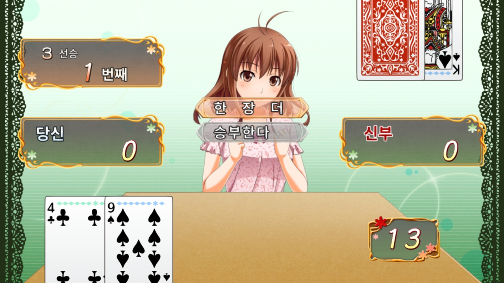

# 나의 신부 \~당신만의 새 신부\~ 한글 패치

## 개요

XBOX 360 독점 게임인 `나의 신부 ~당신만의 새 신부~`의 한글패치를 제공하는 프로그램입니다.

## 샘플 이미지

  
   
  
  

## 지원되는 기능
* 일본어 텍스트 및 일본어 이미지 한글로 교체
* DLC 번역
* 치트 옵션 제공
  * 인트로 스킵
  * 개발자 모드 활성화

## 패치 방법
* 프로그램을 실행시킵니다.
* 원본 ISO를 각각 드래그 & 드롭 합니다.
  * DLC를 보유한 경우 DLC가 들어있는 폴더도 드래그 & 드롭 합니다.
* [한글 패치] 버튼을 눌러 패치를 진행 합니다.
* 패치된 iso 파일은 _repacked 이름이 추가되어 원본 iso와 같은 경로에 저장됩니다.
  * 개발자 모드 활성시에는 _repacked_debug 이름이 추가됩니다.
  * DLC 폴더는 _repacked 이름이 추가되어 원본 폴더와 같은 경로에 저장됩니다.

## 요구사항
* Windows 10 이상
* 정품 게임 ISO

## 다운로드
**[릴리즈 페이지](../../releases)** 에서 다운로드하세요.

본 패치를 다운로드하거나 사용하는 경우 아래의 면책조항 및 이용안내를 확인하고 이에 동의한 것으로 간주합니다.

## 면책조항

본 프로젝트는 비영리 목적의 팬 번역 프로젝트이며, 원작의 저작권은 해당 권리자에게 있습니다.

본 프로젝트는 게임 데이터, 실행 파일 또는 기타 저작권이 있는 원본 데이터를 포함하거나 배포하지 않습니다.

패치를 사용하려면 사용자가 합법적으로 취득한 원본 게임이 필요합니다.

프로젝트 운영자는 본 패치의 사용으로 인해 발생하는 어떠한 손해나 문제에 대해서도 책임을 지지 않습니다.

권리자의 요청이 있을 경우 본 프로젝트는 관련 자료의 공개를 중단하거나 삭제하는 등 필요한 조치를 취할 수 있습니다.

## 라이선스

이 프로젝트는 MIT License를 따릅니다. 자세한 내용은 LICENSE 파일을 참고해 주세요.

Copyright (c) 2026 Gideon

### Fonts

이 프로젝트는 경기천년체 폰트를 사용하고 있습니다.

© GYEONGGI PROVINCE. All Rights Reserved.

### Third-Party Software

This product includes software developed by in <in@fishtank.com>.

자세한 내용은 'docs/THIRD_PARTY_NOTICES' 디렉터리를 참고해 주세요.
